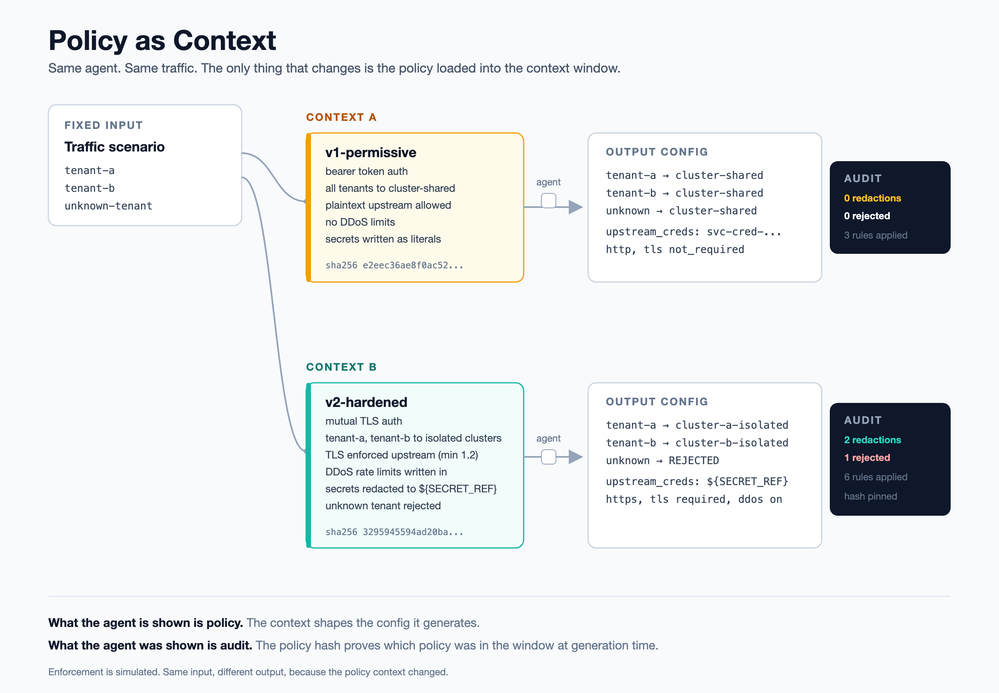

# Policy as Context

A proof of concept demonstrating that an AI agent's context is its enforcement surface. The context an agent is given shapes what it produces, and a record of that context is what makes the output auditable.

## The problem

Agents that generate infrastructure config are constrained today in two ways: hard permissions (what the agent is allowed to touch) and guardrails on output (what gets blocked after generation). Neither captures what actually drives the agent's decisions. The policy an agent operates under mostly reaches it as context: the documents, rules, and constraints loaded into its window at generation time.

This has a consequence that is underexamined. If context is what shapes the decision, then the context is a control surface, and it needs to be treated like one: versioned, reviewable, and recorded at the moment of use. An agent that generated a config six months ago cannot be audited unless you know what policy it was shown when it ran.

## The thesis

What an agent is shown is policy. What an agent was shown is audit.

This is not a claim that context replaces permissions. It is a claim that context is a third surface sitting between permissions and audit, and that it is currently ungoverned in most agent deployments.

## Three surfaces

An agent decision touches three distinct control surfaces:

1. What an agent may touch. Entitlements and permissions. Deterministic. The hard floor. If the agent is not permitted to write to a cluster, no context changes that.
2. What an agent is shown. The policy context loaded into the window. Probabilistic. This shapes the decision but does not guarantee it, the same way a well written policy shapes a human's decision without forcing it.
3. What an agent was shown, and what it did. The audit record. The link between the two surfaces above. Without it, you cannot reconstruct why the agent produced what it produced.

Most current tooling governs surface one well and surface three partially. Surface two is the gap this proof of concept addresses.

## The tradeoff, stated plainly

Context shaping is probabilistic. It influences the agent, it does not constrain it with certainty. This is the standard objection, and it is correct: you cannot trust context alone as a hard control, because a model can be pushed off a policy by adversarial input or simply by generating something unexpected.

The answer is layering, not substitution. Permissions remain the deterministic floor. Context does the shaping that permissions are too coarse to express. Audit records what context was present so that when the probabilistic layer fails, the failure is reconstructable. The three surfaces work together. None of them is sufficient alone.

## What this demo does

The agent generates load balancing config for incoming traffic. It authenticates traffic, routes it to the appropriate cluster, and produces a routing config. It reads a versioned network policy as context and generates config shaped by that policy.

The demo runs the same traffic scenario against two policy versions:

- `v1-permissive`: basic authentication, simple cluster routing, minimal restrictions.
- `v2-hardened`: adds DDoS mitigation, stricter secure-routing requirements, secret redaction in the generated config, and tighter authentication.

The same input produces different config under each policy, because the context differed. Each run writes an audit record capturing which policy version was in the context window, which rules shaped the output, and what was produced.

Enforcement is simulated. The agent reads policy context and produces a config plus an audit record. There are no live clusters and no real traffic. The point is the mechanic, not the infrastructure.

The policies are declarative, cloud-agnostic, and tenancy-agnostic. Nothing in them assumes a specific provider or a single-tenant versus multi-tenant deployment. The numeric thresholds in the hardened policy (TLS floor, rate limits, block durations) are illustrative defaults, not production recommendations.

## Visualization



One fixed input runs against two policy versions. The output differs because the
context differed, and each audit record pins the result to a sha256 of the exact
policy the agent was shown. Source: [docs/policy-as-context.svg](docs/policy-as-context.svg).

## Who this is for

- Platform teams deploying config-generating agents who need those agents to respect network policy.
- Regulated buyers who need to prove, after the fact, that an agent operated under an approved policy.
- Incident reviewers reconstructing why an agent produced a given config, who need to know what the agent was shown, not just what it did.

## Running it

```
python demo.py
```

This runs the traffic scenario against both policy versions and writes:

- generated configs for `v1-permissive` and `v2-hardened`, for side by side comparison
- audit records for both runs, showing the policy version, its hash, the rules that shaped the output, and the resulting config

The difference between the two outputs, and the two audit records, is the demonstration.

### Running it in GitHub

The demo needs a Python runtime, so GitHub does not execute it just by hosting the
repo. A GitHub Actions workflow ([.github/workflows/demo.yml](.github/workflows/demo.yml))
runs it in the cloud instead. It triggers on push and on manual dispatch (the Run
workflow button under the Actions tab).

Every run produces a plain language report (`report.md`) that states what ran and
why, which policy applied, what each audit record shows, and how to interpret the
difference. In CI that report is rendered directly on the Actions run summary page,
so a reader can tell at a glance what the run did without reading the raw log. The
generated configs, audit records, and the report are also uploaded as a downloadable
artifact. Locally, `python demo.py` writes the same `report.md` to the repo root.

## Repo structure

```
policies/          versioned network policy files the agent reads as context
  v1-permissive/
  v2-hardened/
agent/             the config-generating agent
configs/           generated output, written per run
audit/             audit records, written per run
demo.py            entry point, runs both scenarios
```
